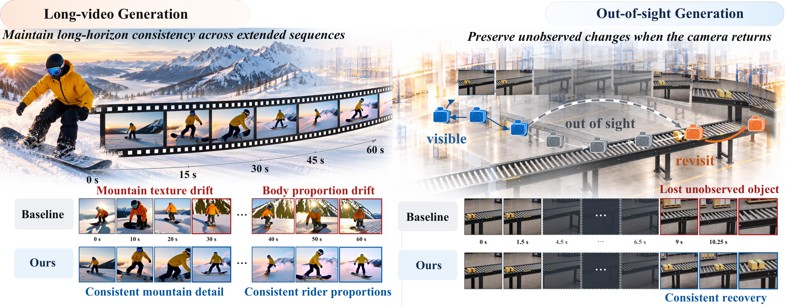
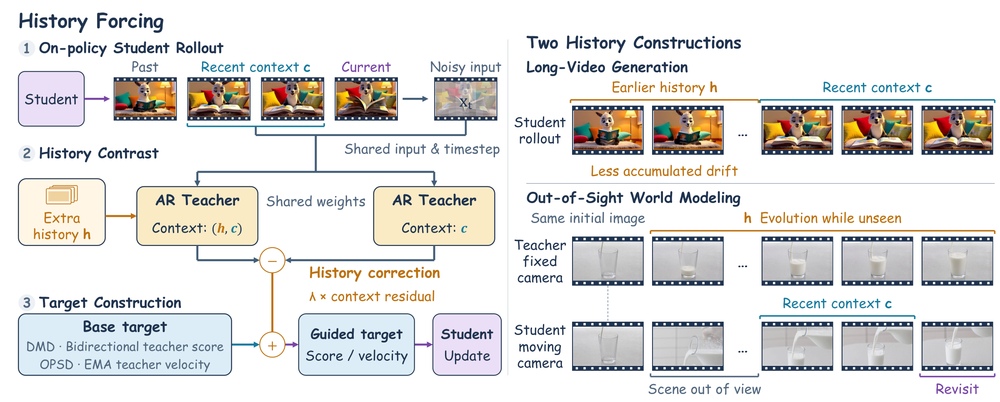

<h1 align="center">History Forcing</h1>
<h3 align="center">Distilling History-Dependent Continuations for Long-Horizon Video World Models</h3>

<p align="center">
  Hangyi Kuang<sup>1,*</sup>, Chengzhi Wang<sup>1,*</sup>, Yefei He<sup>1</sup>, Weijie Wang<sup>1</sup>, Yuke Zhao<sup>1</sup>, Zisu Huang<sup>2</sup><br>
  Yifan Yang<sup>2</sup>, Xiaoxuan He<sup>1,†</sup>, Feng Chen<sup>3,†</sup>, Bohan Zhuang<sup>1</sup>
</p>

<p align="center">
  <sup>1</sup> Zhejiang University &nbsp; <sup>2</sup> Microsoft Research &nbsp; <sup>3</sup> Adelaide University<br>
  <sup>*</sup> Equal contribution &nbsp; <sup>†</sup> Corresponding authors
</p>

<p align="center">
  
  <a href="https://ziplab.co/History-Forcing-Project-Page/"></a>
  <a href="https://huggingface.co/xzxxntxdy/History-Forcing"></a>
  <a href="https://huggingface.co/datasets/xzxxntxdy/History-Forcing-Data"></a>
</p>

<p align="center">
  <a href="#news">News</a> &nbsp;·&nbsp;
  <a href="#method-overview">Method</a> &nbsp;·&nbsp;
  <a href="#installation">Installation</a> &nbsp;·&nbsp;
  <a href="#models-and-data">Models &amp; Data</a> &nbsp;·&nbsp;
  <a href="#quick-start">Quick Start</a> &nbsp;·&nbsp;
  <a href="#training">Training</a> &nbsp;·&nbsp;
  <a href="#evaluation">Evaluation</a>
</p>

<p align="center">
  
</p>

**History Forcing** is a unified **on-policy distillation framework** for few-step autoregressive video models. It strengthens historical supervision to support consistent long-video generation and plausible scene evolution while regions are out of sight.

History Forcing introduces:

1. **History-contrast supervision.** Comparing teacher predictions with and without informative history isolates the influence of history on the current prediction. This correction strengthens historical constraints separately from the base generative supervision.
2. **Long-video consistency.** Earlier segments of the student rollout provide subject and scene information less affected by accumulated drift. The resulting history correction guides DMD while retaining the bidirectional teacher's visual-quality supervision.
3. **Out-of-sight evolution.** Fixed-camera teacher rollouts capture how a region evolves while the student looks away. History-guided on-policy self-distillation then supervises the student's continuation when the camera returns.

## News

- **2026-10-30:** 🚀 We provide inference, training and evaluation code for long-video generation and out-of-sight world modeling.
- **Coming soon:** Paper and public release of model checkpoints and datasets.

## Method Overview

<p align="center">
  
</p>

## Installation

Use Linux with an NVIDIA GPU and a CUDA toolkit compatible with CUDA 12.8.

```bash
conda create -n history-forcing -c conda-forge python=3.12 ffmpeg -y
conda activate history-forcing
pip install -U 'pip<25.3' setuptools==69.5.1 wheel==0.43.0 \
  torch==2.8.0 torchvision==0.23.0 torchaudio==2.8.0
pip install -r requirements.txt
```

Run all commands from the repository root. MemoBench also requires the [evaluation dependencies](opsd/evaluation/memobench/README.md#setup).

## Models and Data

| Model | Backbone | Checkpoint |
|:---|:---|:---:|
| Long-video generator | Wan2.1-T2V-1.3B | [🤗 DMD](https://huggingface.co/xzxxntxdy/History-Forcing/tree/main/dmd) |
| World model | DreamX-World-5B | [🤗 OPSD](https://huggingface.co/xzxxntxdy/History-Forcing/tree/main/opsd) |
| Autoregressive teacher | Wan2.1-T2V-1.3B | [🤗 AR teacher](https://huggingface.co/xzxxntxdy/History-Forcing/tree/main/ar_teacher) |

The released DMD checkpoint was trained with the 10-second AR teacher.

The [🤗 History-Forcing-Data](https://huggingface.co/datasets/xzxxntxdy/History-Forcing-Data) dataset contains prepared training inputs, PlayWorld OOS tasks and MemoBench Real scenes. The commands below save weights to `models/`, data to `dataset/` and generated videos to `output/`.

## Quick Start

### Long-video generation

Download the backbone and generator:

```bash
hf download Wan-AI/Wan2.1-T2V-1.3B \
  --local-dir models/Wan2.1-T2V-1.3B
hf download xzxxntxdy/History-Forcing dmd/model.pt \
  --local-dir models/History-Forcing
```

Generate a 60s video:

```bash
bash scripts/long_video/inference.sh \
  --prompt "A musician strumming the strings of an acoustic guitar, lost in the melody of their song." \
  --output-dir output/demo/long_video
```

See [long-video inference](dmd/long_video/README.md) for prompt lists, seeds and generation settings.

### Out-of-sight world modeling

Download the backbone, generator and prepared inputs:

```bash
hf download GD-ML/DreamX-World-5B config.json model.safetensors \
  --local-dir models/DreamX-World-5B
hf download Wan-AI/Wan2.2-TI2V-5B \
  Wan2.2_VAE.pth models_t5_umt5-xxl-enc-bf16.pth \
  google/umt5-xxl/special_tokens_map.json google/umt5-xxl/spiece.model \
  google/umt5-xxl/tokenizer.json google/umt5-xxl/tokenizer_config.json \
  --local-dir models/DreamX-World-5B
hf download xzxxntxdy/History-Forcing opsd/model.pt \
  --local-dir models/History-Forcing
hf download xzxxntxdy/History-Forcing-Data --repo-type dataset \
  --local-dir dataset/History-Forcing
```

Generate from an initial image, a scene prompt and camera actions:

```bash
bash scripts/world_model/run.sh inference \
  --checkpoint models/History-Forcing/opsd/model.pt \
  --num-samples 1
```

See [custom world-model inputs](opsd/README.md#custom-inputs) for input formats.

## Training

For Weights & Biases logging, run `wandb login` once before training.

### Long-video distillation

In addition to the long-video backbone above, download the AR teacher, initialization weights and text prompts, then start training:

```bash
hf download xzxxntxdy/History-Forcing ar_teacher/model.pt \
  --local-dir models/History-Forcing
hf download zhuhz22/Causal-Forcing chunkwise/ar_diffusion.pt chunkwise/causal_ode.pt \
  --local-dir models/Causal-Forcing
hf download gdhe17/Self-Forcing vidprom_filtered_extended.txt --local-dir dmd/prompts

bash scripts/long_video/train.sh
```

See [DMD training](dmd/README.md#training) for configurations, AR teacher fine-tuning and distributed training.

### World-model training

Use the world-model assets downloaded above:

```bash
bash scripts/world_model/run.sh pack
bash scripts/world_model/run.sh train
```

See [OPSD training](opsd/README.md#training) for history guidance and LoRA/FSDP settings.

## Evaluation

| Task | Benchmarks | Guide |
|:---|:---|:---:|
| Long-video generation | VBench · MovieGenBench / VBench-Long | [DMD evaluation](dmd/README.md#evaluation) |
| Out-of-sight world modeling | PlayWorld OOS · MemoBench Real | [OPSD evaluation](opsd/README.md#evaluation) |

## Repository Structure

```text
configs/
├── long_video/     Long-video configurations
└── world_model/    World-model configurations
scripts/
├── long_video/     Long-video launchers
└── world_model/    World-model launchers
dmd/               Long-video implementation and benchmarks
opsd/              World-model implementation and benchmarks
assets/            Paper figures
```

## Acknowledgements

We thank [Causal Forcing](https://github.com/thu-ml/Causal-Forcing), [Self Forcing](https://github.com/guandeh17/Self-Forcing), [DreamX-World](https://github.com/AMAP-ML/DreamX-World), [Wan](https://github.com/Wan-Video/Wan2.1), [MemRoPE](https://github.com/YoungRaeKimm/MemRoPE), [PlayWorld](https://github.com/hku-sail/PlayWorld) and [VBench](https://github.com/Vchitect/VBench) for their open-source contributions.

## License

See [LICENSE](LICENSE). Third-party components retain their respective licenses.
